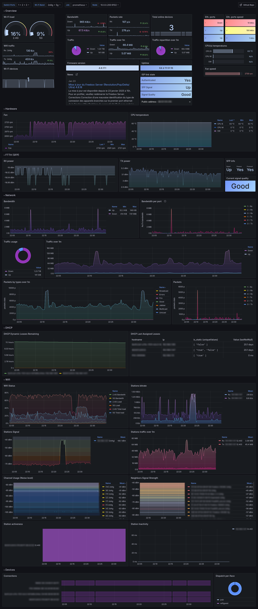

# freebox-exporter-rs

[](https://app.fossa.com/projects/git%2Bgithub.com%2Fshackerd%2Ffreebox-exporter-rs?ref=badge_shield)
[](https://matrix.to/#/#freebox-exporter-rs:matrix.org)
[](
https://discord.gg/QfV2D2KZ)

Yet another [Freebox API](https://dev.freebox.fr/sdk/os/) exporter for Prometheus! This project is actually in work in progress. New contributors are welcome!

> [!IMPORTANT]
> **Disclaimer:** This project is unofficial and is **not affiliated in any way with Free S.A.S. ISP nor Iliad Group**

## Grafana board

You will find on Grafana [gallery](https://grafana.com/grafana/dashboards/21957) the board for the exporter, also source file is located [here](./grafana-board.json)



## Features

* Adaptive Freebox metrics exposition (detects network mode, see: [related issue](https://github.com/shackerd/freebox-exporter-rs/issues/2#issuecomment-2234856496))
* Metrics caching & background update
* Customizable data directory
* Customizable metrics prefix
* Customizable log files retention
* Compressed log files
* Customizable/CLI overridable log verbosity
* CLI overridable configuration file path
* Freebox API certificate validation
* Configurable handling of WiFi stations with unresolved hostnames
* Collector health metrics (success, last success, duration)

## API Implementation

* &#10134; Authentication
  * &#9989; Register: **100%**
  * &#9989; Login: **100%**
* &#10134; Configuration
  * &#10134; Connection
    * &#9989; Status: **100%**
    * &#9989; Configuration: **100%**
    * &#9989; Configuration IPV6: **100%**
    * &#9989; xDSL: **100%**
    * &#9989; FTTH: **100%**
    * &#10060; DynDNS: **0%**
  * &#9989; Lan: **100%**
  * &#9989; Lan Browser: **100%**
  * &#10060; Freeplug: **0%**
  * &#9989; DHCP: **100%**
  * &#9989; Switch: **100%**
  * &#9989; Wi-Fi: **100%**
  * &#9989; System: **100%**
  * &#9989; Storage/NAS: **100%**
  * &#9989; Downloads: **100%**
  * &#9989; VPN Server: **status and connections**
  * &#9989; VPN Client: **status**
  * &#9989; Virtual Machines: **status and resources**
  * &#9989; RAID: **arrays and members state**

## Enhancements

You can suggest your ideas in [discussion section](https://github.com/shackerd/freebox-exporter-rs/discussions/categories/ideas)

## Usage

You will find usage by using the following command `freebox-exporter-rs -h`

``` text
Usage: freebox-exporter-rs [OPTIONS] <COMMAND>

Commands:
  auto                starts the application and registers it if necessary
  register            registers the application
  serve               starts the application
  session-diagnostic  runs a diagnostic on the session
  revoke              
  help                Print this message or the help of the given subcommand(s)

Options:
  -c, --configuration-file <CONFIGURATION_FILE>  
  -v, --verbosity <VERBOSITY>                    
  -h, --help                                     Print help
  -V, --version                                  Print version
```

## WiFi Station Hostname Resolution

The exporter handles WiFi stations that may have incomplete hostname/IP information from the Freebox API. This can occur when:

- Station is connected at Layer 2 but has no Layer 3 connectivity
- DHCP lease has expired
- Device is in sleep mode
- Host information is temporarily unavailable

You can control how these stations are handled via the `[policies]` section in your configuration:

### Policy Options

**`ignore` (recommended)**
- Skips stations without complete host information
- Prevents potential crashes and ensures stable operation
- Only shows stations with fully resolved hostnames and IP addresses

**`relabel`**
- Includes all detected stations in metrics
- Uses "unresolved" as hostname/IP for stations with missing data
- Provides complete visibility of all connected devices
- Useful for troubleshooting and monitoring all WiFi activity

Example configuration:
```toml
[policies]
unresolved_station_hostnames = "ignore"  # or "relabel"
```

## NAS Storage Metrics

The exporter provides comprehensive metrics for Freebox NAS storage functionality, exposing detailed information about attached disks and their partitions.

### Disk Metrics

- **Storage capacity**: Total disk size in bytes
- **Disk state**: Current state (enabled, disabled, error, formatting)
- **Temperature**: Disk temperature in Celsius (for supported drives)
- **Power management**: Spinning status, idle state, and timing information
- **Hardware info**: Disk type (internal, USB, SATA), model, serial, firmware
- **Performance**: Active/idle duration, time before spindown
- **Physical info**: Connector ID, partition table type
- **Operations**: Progress percentage and step counts for ongoing operations

### Partition Metrics

- **Storage usage**: Total, used, and free space in bytes
- **Partition state**: Mount status (mounted, unmounted, error, etc.)
- **Filesystem info**: Filesystem type and partition labels
- **Health**: FSCK results and status
- **Operations**: Progress percentage and step counts for partition operations

### Configuration

Enable NAS metrics by setting `nas = true` in your configuration file:

```toml
[metrics]
nas = true
```

**Note**: NAS metrics use the Freebox Storage API which is marked as **[UNSTABLE]** in the official documentation and may change in future Freebox firmware updates.

Example metrics exposed:
```
fbx_exporter_nas_disk_total_bytes{disk_id="1",disk_type="internal",model="Hitachi HCC545025B9A300",serial="GSCH35VC"} 250059350016
fbx_exporter_nas_disk_temperature_celsius{disk_id="1",disk_type="internal",model="Hitachi HCC545025B9A300",serial="GSCH35VC"} 51
fbx_exporter_nas_partition_used_bytes{partition_id="3",disk_id="1",label="Disque dur",fstype="ext4"} 164520534016
```

## Download Metrics

The exporter can expose global downloader statistics from Freebox OS Download API endpoint `/api/v4/downloads/stats`.

### Configuration

Enable Download metrics by setting `download = true` in your configuration file:

```toml
[metrics]
download = true
```

### Exposed Metrics

- **Traffic**: current downloader RX/TX rate in bytes per second
- **Tasks**: total tasks and per-state counters (active, downloading, seeding, queued, stopped, checking, extracting, done, repairing, error, stopping)
- **Downloader state**: connection readiness, peer count, unread RSS items
- **Throttling**: current mode, schedule flag, and throttling RX/TX rates

Example metrics exposed:
```
fbx_exporter_download_rx_rate_bytes_per_second 14222
fbx_exporter_download_tx_rate_bytes_per_second 4294
fbx_exporter_download_tasks_active 11
fbx_exporter_download_tasks_downloading 4
fbx_exporter_download_tasks_stopped 1
fbx_exporter_download_throttling_mode_info{mode="normal"} 1
```

## Collector Health Metrics

Each collector exposes the outcome of its last run, so a failing collector (missing permission, unsupported endpoint, API error) is visible in Prometheus and not only in the logs:

```
fbx_exporter_collector_success{collector="vm"} 1
fbx_exporter_collector_last_success_timestamp_seconds{collector="vm"} 1794097253
fbx_exporter_collector_duration_seconds{collector="vm"} 0.064
```

`collector_success` is 0 when the collector failed. The lan_browser and wifi collectors also report 0 when the devices of an interface or an expected access point could not be fetched, while still exposing the others; failures of the optional wifi channel usage and neighbors endpoints, unavailable on some models, are only logged at debug level. The last success timestamp is kept when a collector fails; the vm, raid and vpn collectors also keep exposing their last known values. A collector requested in the configuration but whose support could not be detected at startup is exposed with `collector_success` 0 until the exporter restarts. Each request to the box times out after 10 seconds.

A collector that never succeeded has no last success timestamp, so alert on both failing and stale collectors, for instance:

```
fbx_exporter_collector_success == 0
time() - fbx_exporter_collector_last_success_timestamp_seconds > 300
```

with a `for` duration of a few refresh intervals on the first rule.

## API Version Support

Each new collector calls a fixed API version prefix, and is disabled when the box API version (read from `/api_version` at startup) is lower. The prefixes below were checked on a Freebox Delta (API 16): the vm and vpn endpoints answer identically from their minimum version up to 16. The raid minimum is the version of the first documentation of the endpoint, its actual introduction version is unknown:

| Collector | Minimum API version | Additional requirement |
|-----------|---------------------|------------------------|
| vm | 7 | VM capable hardware (`model_info.has_vm`, e.g. Delta, Ultra) and the "VM" application permission |
| raid | 8 | |
| vpn | 4 | router mode |

## Virtual Machine Metrics

Enable with `vm = true`. The application must be granted the "VM" permission in Freebox OS (Settings > Access management > Applications), otherwise `fbx_exporter_collector_success{collector="vm"}` is 0 and the logs report `insufficient_rights`.

```
fbx_exporter_vm_running{id="0",name="adguard"} 1
fbx_exporter_vm_status{id="0",name="adguard",status="running"} 1
fbx_exporter_vm_memory_allocated_bytes{id="0",name="adguard"} 2147483648
fbx_exporter_vm_vcpus{id="0",name="adguard"} 2
fbx_exporter_vm_info{disk_type="qcow2",id="0",name="adguard",os="ubuntu"} 1
fbx_exporter_vm_host_memory_total_bytes 7516192768
fbx_exporter_vm_host_memory_allocated_bytes 2147483648
fbx_exporter_vm_host_vcpus 3
fbx_exporter_vm_host_vcpus_allocated 2
```

Memory and vCPUs are the resources allocated to the VM, not its actual usage: use an exporter inside the VM for that.

## RAID Metrics

Enable with `raid = true`. Without any RAID array no series is exposed. Behaviour on models without internal SATA bays has not been verified.

```
fbx_exporter_raid_degraded{id="0",level="raid5",name="Freebox"} 0
fbx_exporter_raid_state{id="0",name="Freebox",state="running"} 1
fbx_exporter_raid_sync_action{id="0",name="Freebox",sync_action="idle"} 1
fbx_exporter_raid_sync_completed_ratio{id="0",level="raid5",name="Freebox"} 0
fbx_exporter_raid_member_role{array_id="0",device_location="sata-internal-p1",id="1000",role="active"} 1
fbx_exporter_raid_member_corrected_read_errors{array_id="0",device_location="sata-internal-p1",id="1000"} 0
fbx_exporter_raid_member_temperature_celsius{array_id="0",device_location="sata-internal-p1",id="1000"} 43
```

Also exposed: `raid_sync_speed_bytes_per_second`, `raid_size_bytes`, `raid_disks_expected`, `raid_last_check_timestamp_seconds`, `raid_next_check_timestamp_seconds` (absent when zero: never checked or no check scheduled) and `raid_member_size_bytes`.

## VPN Metrics

Enable with `vpn = true`. Connection traffic is aggregated per VPN server: user logins and IP addresses are never exposed.

```
fbx_exporter_vpn_server_state{name="wireguard",state="stopped",type="wireguard"} 1
fbx_exporter_vpn_server_started{name="wireguard",type="wireguard"} 0
fbx_exporter_vpn_server_connections{name="wireguard",type="wireguard"} 0
fbx_exporter_vpn_server_authenticated_connections{name="wireguard",type="wireguard"} 0
fbx_exporter_vpn_connections_rx_bytes{vpn="wireguard"} 94
fbx_exporter_vpn_client_enabled 0
```

When the VPN client is enabled, `vpn_client_up`, `vpn_client_state`, `vpn_client_last_error`, rates, `vpn_client_uploaded_bytes_total`, `vpn_client_downloaded_bytes_total` (counters; a value lower than the previous one is exposed as a counter reset) and `vpn_client_last_up_timestamp_seconds` are also exposed, each one only when returned by the box.

## Running project

Running with docker

``` bash
docker pull ghcr.io/shackerd/freebox-exporter-rs:latest
```

``` yaml
version: '3.8'

services:
  freebox-exporter:
    image: ghcr.io/shackerd/freebox-exporter-rs:latest-amd64
    container_name: freebox-exporter
    volumes:
      - ./config:/etc/freebox-exporter-rs
      - ./data:/data
    ports:
      - "9102:9102"
    restart: unless-stopped
    command: ["/usr/bin/freebox-exporter-rs", "-c", "/etc/freebox-exporter-rs/config.toml" ,"auto"]
```

> [!IMPORTANT]
> **port** must match with value set in your **configuration file**
> `data` volume path must match with `data_directory` value set in your **configuration file**

## Configuring

``` toml
[api]
# Refresh wait interval in seconds, application will send requests to the freebox host on each refresh iteration
# This does not affect prometheus scrap agents, application will use cached values between calls
# Remark:
#   more you set API exposition (c.f: [metrics] section) more requests will be sent,
#   setting a too low interval between refreshs could lead to request rate limiting from freebox host
refresh = 5

[metrics]
# Exposes connection
connection = true
# Exposes lan
lan = true
# Exposes lan browser, this option will be disabled if freebox is in bridge_mode
lan_browser = true
# Exposes switch, this option will be disabled if freebox is in bridge_mode
switch = true
# Exposes wifi, this option will be disabled if freebox is in bridge_mode or device is disabled on the host
wifi = true
# Exposes dhcp, this option will be disabled if freebox is in bridge_mode
dhcp = true
# Exposes system
system = true
# Exposes NAS storage information (disks and partitions)
nas = true
# Exposes global downloader statistics (/api/v4/downloads/stats)
download = true
# Exposes virtual machines, requires a Freebox supporting VMs (Delta, Ultra) and the "VM" permission granted to the application
vm = true
# Exposes RAID arrays state
raid = true
# Exposes VPN servers and client state
vpn = true
# Sets metrics prefix, it cannot be empty
# Warning if you are using the exporter Grafana board, changing this value will cause the board to be unable to retrieve data if you do not update it
prefix = "fbx_exporter"

[policies]
# Specify how to handle WiFi stations with unresolved hostnames (missing host data from Freebox API)
unresolved_station_hostnames = "ignore"
# Acceptable values :
#   * "ignore"  : Skip stations without host data (recommended for stability)
#   * "relabel" : Include stations with "unresolved" labels for missing host information

[core]
# Specify where to store data for exporter such as APP_TOKEN, logs, etc. Set to "/data" if you use docker, otherwise you will have to register the freebox-exporter-rs everytime you remake the container
data_directory = "."
# Specify which TCP port to listen to, for the /metrics HTTP endpoint
port = 9102

[log]
# Specify which log level to use
# Acceptable values :
#   * "Off"     : A level lower than all log levels
#   * "Error"   : Corresponds to the `Error` log level
#   * "Warn"    : Corresponds to the `Warn` log level
#   * "Info"    : Corresponds to the `Info` log level
#   * "Debug"   : Corresponds to the `Debug` log level
#   * "Trace"   : Corresponds to the `Trace` log level
level = "Info"
# Specify how long application should keep compressed log files, value is in days
retention = 31
```

## Building, debugging

### Clone project

``` bash
git clone --recurse-submodules https://github.com/shackerd/freebox-exporter-rs.git && cd freebox-exporter-rs
```

### Run

``` bash
cargo run auto
```

The `auto` command will prompt the user to consent the application if needed, otherwise it will **serve** the metrics on http.

* See the `serve` command if you want to only serve the metrics.
* See the `register` command if you want to only register the application.

> [!TIP]
> You can change output log level by specifying verbosity, such as `cargo run -- -v Debug auto`

### Running tests

Run the following command.

``` bash
cargo test
```

### Verify it works

If you changed port in `conf.toml`, update the command line below.

``` bash
curl http://localhost:9102/metrics
```

## Troubleshooting

Having issues? Check our comprehensive [troubleshooting guide](TROUBLESHOOTING.md) which includes:

- Session diagnostic commands
- Raw API data collection for bug reports
- Common issues and solutions
- Advanced debugging techniques

For bug reports, please include diagnostic data as described in the troubleshooting guide.

## License

[](https://app.fossa.com/projects/git%2Bgithub.com%2Fshackerd%2Ffreebox-exporter-rs?ref=badge_large)

## Support this project

You like this project? Don't forget to leave a :star:!

If you want to help :heart:, you can contribute, give feedbacks or you can still [buy me a :coffee:](https://ko-fi.com/shackrd), i like coffee ☕.

## Useful links

* [https://dev.freebox.fr/blog](https://dev.freebox.fr/blog) : official Freebox blog
* [https://dev.freebox.fr/bugs](https://dev.freebox.fr/bugs) : official Freebox bugs report board
